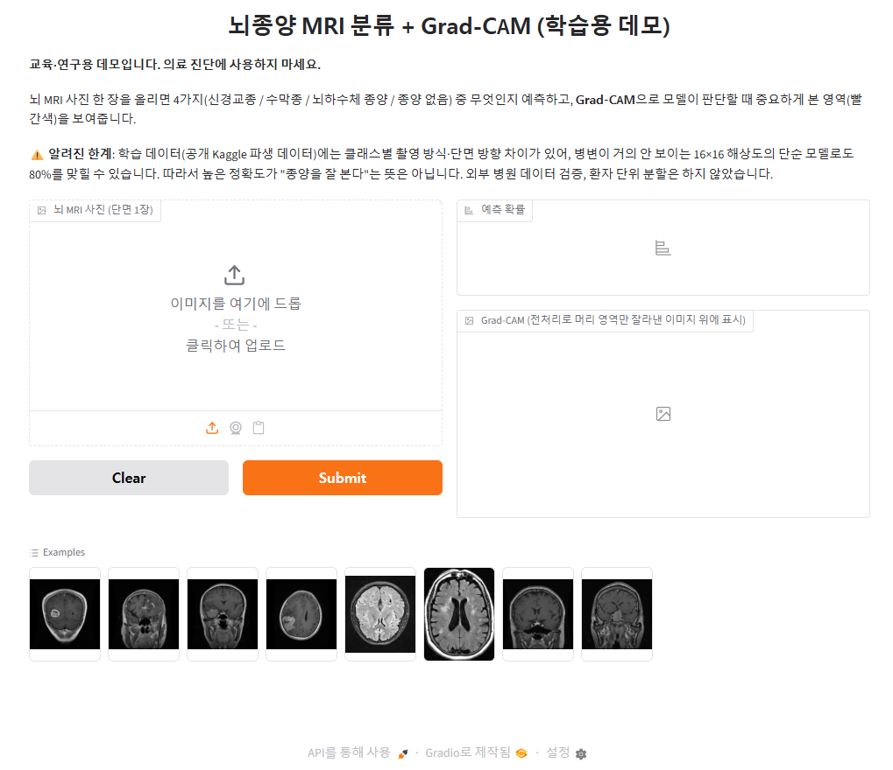
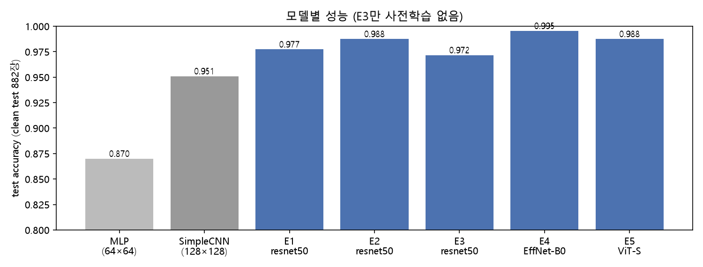
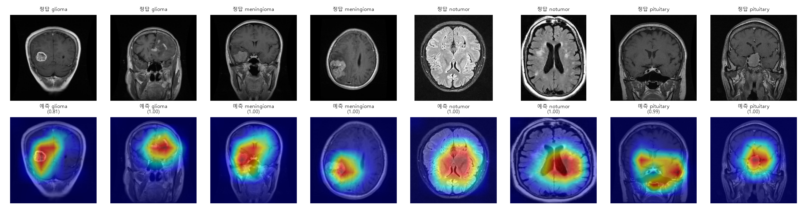

# 프로젝트 1. 뇌종양 MRI 4클래스 분류 — "99%를 얼마나 믿을 수 있나?"

뇌 MRI 단면 한 장을 **glioma / meningioma / notumor / pituitary**로 분류하는 모델을
MLP → 직접 만든 CNN → 사전학습 모델 순으로 만들고, **높은 성능이 정말 "종양을 잘 본다"는 뜻인지** 검증한 프로젝트입니다.

- 🤗 모델: https://huggingface.co/yerim0827/brain-mri-tumor-resnet50-gradcam
- 🧪 데모: 로컬 실행 ('cd demo && phtuon app.py')

## 핵심 결과

| 실험 | 모델 | 사전학습 | 자르기 | 증강 | test acc | macro F1 | glioma↔meningioma 오분류 |
|---|---|---|---|---|---|---|---|
| 노트북 2 | MLP (64×64) | ❌ | ❌ | ❌ | 0.870 | 0.870 | 76 |
| 노트북 3 | SimpleCNN (128×128) | ❌ | ❌ | ❌ | 0.951 | 0.955 | – |
| E1 | resnet50 | ✅ | ❌ | ❌ | 0.977 | 0.979 | 13 |
| E2 | resnet50 | ✅ | ✅ | ✅ | 0.988 | 0.988 | 7 |
| E3 | resnet50 | ❌ | ✅ | ✅ | 0.972 | 0.973 | 15 |
| E4 | efficientnet_b0 | ✅ | ✅ | ✅ | 0.995 | 0.996 | 1 |
| E5 | vit_small_patch16_224 | ✅ | ✅ | ✅ | 0.988 | 0.988 | 7 |

## 진행 과정
| 노트북 | 내용 | 주요 발견 |
|---|---|---|
| [01 EDA](notebooks/01_data_explore.ipynb) | 데이터 구조, 채널·크기, **중복·누수 검사** | test의 **31.5%(413장)가 train에 쌍둥이** → 7,023 → 5,980장으로 정리. 클래스별로 촬영 방식(notumor=T2)·단면 방향(pituitary=sagittal·coronal만)이 다름 |
| [02 MLP](notebooks/02_pytorch_mlp.ipynb) | PyTorch 기초, 학습 루프 | acc 0.870, 오류의 66%가 glioma↔meningioma. **외울수록 누수가 점수를 부풀림**(60ep: +1.3%p, meningioma +12.9%p) |
| [03 CNN](notebooks/03_cnn_from_scratch.ipynb) | 합성곱·풀링, 직접 만든 CNN | acc 0.951, glioma↔meningioma 오분류 76 → 27장. lr 3e-4 + cosine으로 학습 안정화. Grad-CAM에서 notumor·pituitary가 **머리 테두리**를 봄 |
| [04 전이학습](notebooks/04_pretrained_transfer.ipynb) | ResNet50, EfficientNet-B0, ViT-Small + 뇌 영역 자르기 + 증강 | 사전학습 모델 0.977~0.995. 사전학습은 성능보다 **학습 안정성**에 큰 효과. Grad-CAM이 뇌 안쪽으로 이동 |
| [05 검증](notebooks/05_evaluation_deep_dive.ipynb) | bootstrap CI, 오답 분석, 지름길 테스트, Grad-CAM 정량화, 보정 | **16×16 로지스틱 회귀로도 80.7%** → 데이터에 지름길 존재. 자르기+증강으로 Grad-CAM 안쪽 비율 0.783 → 0.883 |
| [06 배포](notebooks/06_deploy_huggingface_gradio.ipynb) | 허깅페이스 업로드, Gradio 데모 | 데모 전처리로 test 재평가 → 학습 결과와 일치 확인 |

## 한계 (Limitations)
1. **데이터 지름길**: 종양이 안 보이는 16×16 해상도의 로지스틱 회귀로도 80.7% (notumor 0.92, pituitary 0.88). 높은 정확도 ≠ 종양을 잘 봄
2. **성능 1등 ≠ 올바른 이유**: EfficientNet(0.995)은 notumor에서 테두리를 섞어 보고, 안쪽만 보여줬을 때 가장 잘 맞힌 건 ViT(0.946)
3. **환자 단위 분할 불가** (환자 ID 없음): 오답이 연속 파일 번호에 몰림 → 같은 환자 묶음이 점수를 좌우할 수 있음
4. **외부 검증 없음**, 단일 시드 (EfficientNet > ResNet50·ViT는 통계적으로 단정 불가: Bonferroni 보정 시 비유의)
5. 사진 위 화살표 표시 존재, 단면 한 장 4분류는 실제 진료를 크게 단순화한 문제

## 실행 방법
1. 데이터: [Mendeley Data](https://data.mendeley.com/datasets/5kbjrgsncf/3)에서 받아 `data/raw/`에 압축째로 넣기 (CC BY 4.0)
2. 환경: Python 3.12, PyTorch(CUDA), `pip install timm scikit-learn pandas matplotlib tqdm grad-cam scipy gradio huggingface_hub`
3. `notebooks/` 01 → 06 순서로 실행 (GPU: RTX 3080 기준 전체 약 1.5시간)
4. 데모만 실행: `cd demo && python app.py`

## 데이터 출처
Mendeley Data, *Medical Imaging (CT scan, MRI, X-ray, and Microscopic Imagery) Data* (CC BY 4.0) — Brain Tumor 부분. 원 출처는 Kaggle 공개 데이터셋.
`demo/examples/`의 예시 사진 8장은 이 데이터에서 가져왔습니다.

> ⚠️ 교육·연구 목적의 학습 프로젝트입니다. 의료 진단에 사용할 수 없습니다.
